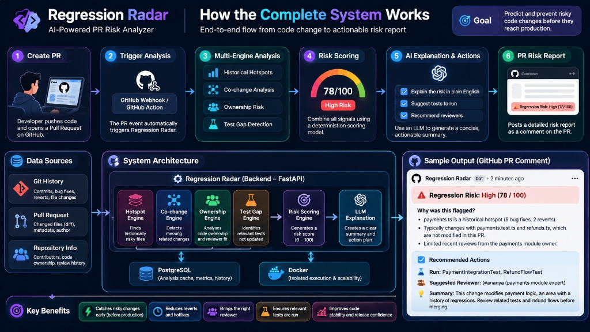

# Regression Radar

**AI-powered Pull Request risk analyser** — predicts which code changes deserve extra scrutiny before merging.



---

## What it does

Regression Radar analyses a proposed PR using **repository history** and generates an explainable **risk-prioritisation score** (0–100), supporting evidence, and recommended actions.

It is **not**:
- A generic linter or code-quality checker
- A replacement for CI or human code review
- An LLM that guesses whether code is buggy
- A system that guarantees production safety

Its differentiator: **PR-time, history-aware risk analysis with actionable recommendations.**

---

## Four analysis signals

| Signal | What it detects |
|---|---|
| **Historical Hotspot** | Files with disproportionate bug-fix and revert history (Bayesian smoothed) |
| **Co-change Pattern** | Files that frequently change together — missing partners in PR are flagged |
| **Test Gap** | Substantive source files changed without corresponding test coverage |
| **Ownership** | Domain experts and recent maintainers suggested as reviewers |

---

## Risk-prioritisation score

| Score | Category |
|---|---|
| 0–29 | 🟢 Low |
| 30–59 | 🟡 Medium |
| 60–79 | 🟠 High |
| 80–100 | 🚨 Critical |

> ⚠️ A score of 80 is a **risk-prioritisation score**, not a calibrated failure probability.

---

## Quick start

### Prerequisites

- Python 3.11+
- Git on PATH

### Install

```bash
cd regression-radar
pip install -e ".[dev]"
```

### Analyse a Pull Request or local changes

```bash
# Full analysis: terminal report
rr analyse /path/to/repo --base main

# Generate GitHub PR comment in Markdown
rr analyse /path/to/repo --base main --format markdown

# Save directly to a comment file for GitHub Actions
rr analyse /path/to/repo --base main --format markdown --output comment.md

# Output JSON for API integrations
rr analyse /path/to/repo --base main --format json
```

### GitHub PR URL Analysis (Web & API)

You can analyze public or private GitHub PRs directly by URL without manually cloning repositories:

- **Web UI:** Switch to the **GitHub PR** tab in the *PR Intelligence* view, paste the PR URL (e.g. `https://github.com/owner/repo/pull/123`), and click **Analyse PR**.
- **REST API:** `POST /api/v1/analyze/github-pr` with payload `{"pr_url": "https://github.com/owner/repo/pull/123", "use_ai": false}`.
- **Credentials:** Set `GITHUB_TOKEN` in the backend environment. Public repositories work out-of-the-box (60 req/hr rate limit); private repositories require a token with `repo` scope. Tokens remain strictly server-side.

### Run tests

```bash
python -m pytest
```

---

## Reproduce the Hackathon Demo

Regression Radar includes a self-contained, reproducible demo repository that matches the end-to-end architecture scenario:

```bash
# 1. Build the controlled scenario repo
python examples/build_demo_repo.py

# 2. Run Regression Radar on the feature branch
rr analyse examples/demo-repo --base main --author "junior@example.com"
```

The output will automatically detect:
- `src/payments.ts` as a historical hotspot (5 past fixes/reverts)
- Missing co-change partner `src/refunds.ts`
- Untouched test coverage `tests/payments.test.ts`
- Candidate reviewer recommendation: `Ananya Sharma (ananya@example.com)`

---

## GitHub Actions Integration

Regression Radar includes a ready-to-run GitHub Action workflow in [`.github/workflows/regression-radar.yml`](.github/workflows/regression-radar.yml).

On every pull request, it runs analysis against the base branch and posts a formatted, sticky comment to the PR discussion. Subsequent commits update the comment without spamming notifications.

---

## Evaluation & Metrics

See [`docs/EVALUATION.md`](docs/EVALUATION.md) for detailed evaluation methodology, benchmark comparisons against trivial churn/random baselines, and transparent limitations.
